= Convert photo to Commodore 64

== Overview

This program reads a PNM image file on standard input and writes a PPM image file on standard output.
The output image adheres to the color palette and pixel block restrictions of the Commodore 64's "hi-res" graphics mode.

== Usage

....
Usage: convert-photo-to-c64 [-d STRENGTH] <input.ppm >output.ppm

Where:
  -d STRENGTH  Set the dither strength to STRENGTH%. Must not be less
               than 0. Default is 400.
....

The default dither strength works reasonably well for most pictures, but some pictures may benefit from a strength higher or lower.
A dither strength of 0 gives a posterized effect.

== How it works

In the standard "high-res" video mode, the Commodore 64 supports a palette of 16 colors and divides the screen into 8x8 pixel blocks.
Each pixel in a block may be one of only two colors.

This program looks at each block in the source image and attempts to find:

* two Commodore 64 colors that best describe the colors in the source image, and
* an arrangement of those two colors that best matches the source image.

This program uses brute-force matching to find the best colors.
For each pair of colors, it finds the best arrangment of pixels for that pair.
The pair that provides the best arrangement is chosen.

The initial pixel arrangement for a given pair of colors is simply a checkerboard pattern.
That arrangement is then refined genetically: a pixel is chosen at random, and if changing the pixel to the other color in the pair gives a better pixel arrangement, the other color is chosen instead.
This algorithm is repeated at least once for each pixel in a block.
If the block does not change after a few iterations of this algorithm, we assume we have found a near-optimal pixel arrangement.

== Future improvements

The evaluator functions are at the heart of the algorithms.
They determine which block is "best".

Currently the evaluators use the linear RGB values in the source and generated images.
However, other color spaces (such as YUV) may yield better results.

Also, the pixel evaluator may be improved.
It currently uses a 3x3 convolution filter to allow neighboring pixels to influence the score of a pixel.
This causes the generated block to be dithered.
Alternative convolution coefficients give different results.

== Examples

[cols='1a,1a,1a']
|===
|Original                   |Hires                         |Multicolor

|image:afghangirl.png[]     |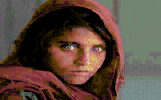  |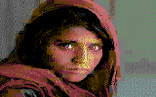
|image:bar.png[]            |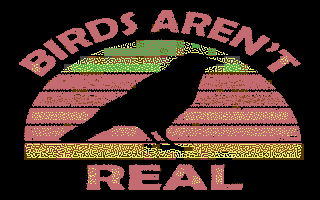         |
|image:birds.png[]          |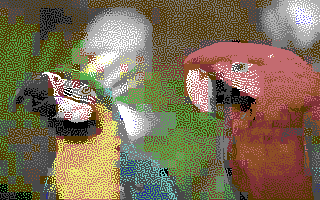       |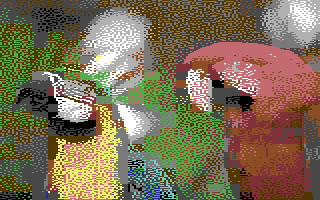
|         |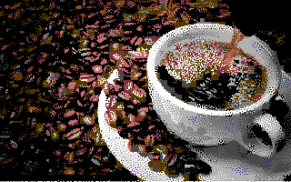      |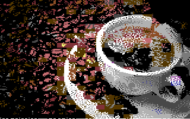
|image:desert.png[]         |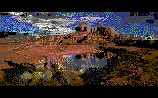      |
|image:dsotm.png[]          |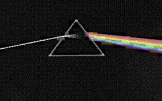       |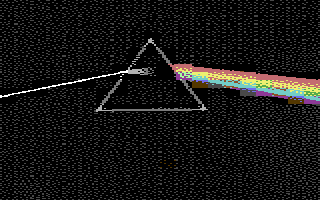
|image:eits.png[]           |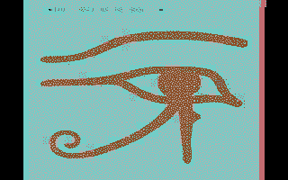        |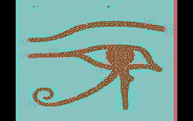
|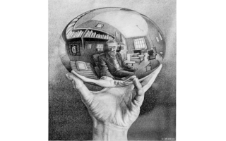         |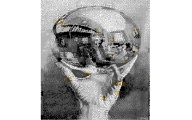      |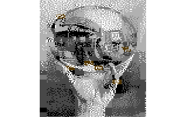
|             |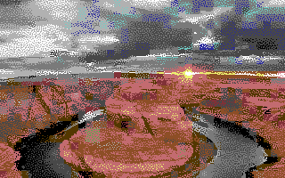          |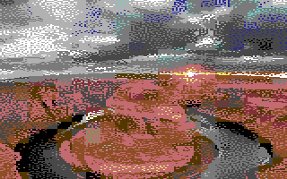
|          |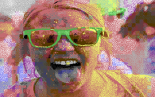       |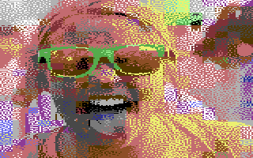
|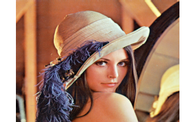           |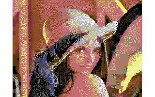        |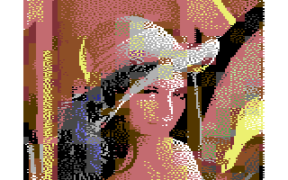
|        |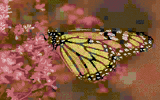     |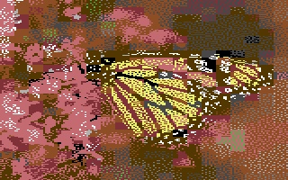
|image:nd.png[]             |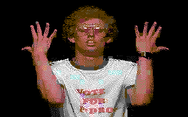          |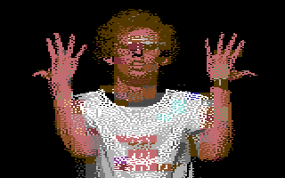
|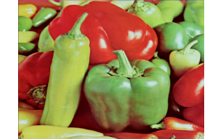        |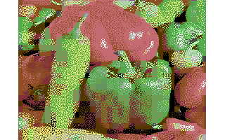     |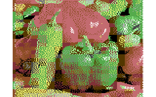
|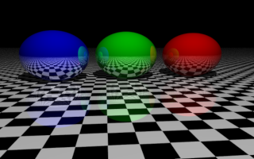       |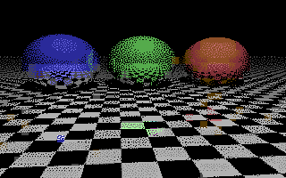    |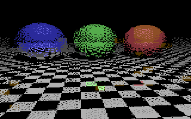
|image:rr.png[]             |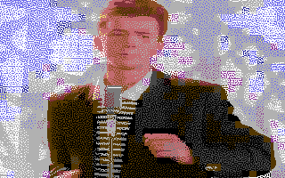          |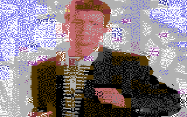
|image:starry-night.png[]   |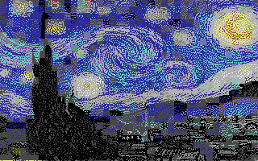|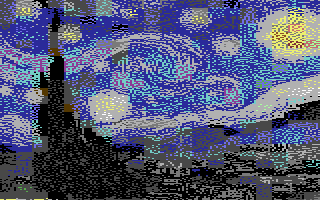
|image:starwars2.png[]      |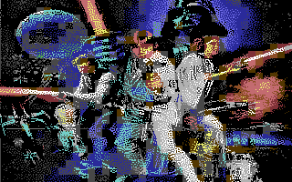   |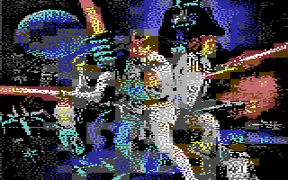
|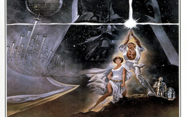       |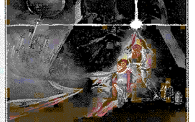    |
|image:webb.png[]           |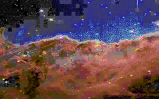        |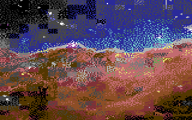
|===
