= Convert photo to Commodore 64

== Overview

This program reads a PNM image file on standard input and writes a PPM image file on standard output.
The output image adheres to the color palette and pixel block restrictions of the Commodore 64's "hi-res" or "multicolor" graphics modes.

== Usage

....
Usage: convert-photo-to-c64 [OPTIONS] <INPUT.pnm >OUTPUT.pnm

Options:
  -b COLOR       Set background color.
  -d STRENGTH    Set dither strength (e.g. 400).
  -m MODE        Set output mode ("hires" or "multicolor").
  -p PALETTE     Load a palette ("colodore" or "pepto").
  -P FILE        Load palette from a VICE palette file.
  -i COLORLIST   Include colors (e.g., "0 1 5").
  -x COLORLIST   Exclude colors.
  -s SATURATION  Set saturation (0% = grayscale, 100% = full saturation).
  -y WEIGHT      Set Y weight (default 5.0)
  -h             Show this help page and exit.
....

The default dither strength works reasonably well for most pictures, but some pictures may benefit from a strength higher or lower.
A dither strength of 0 gives a posterized effect.

== How it works

In the standard "high-res" video mode, the Commodore 64 supports a palette of 16 colors and divides the screen into 8x8 pixel blocks.
Each pixel in a block may be one of only two colors.

This program looks at each block in the source image and attempts to find two Commodore 64 colors that best describe the colors in the source image.
This is done by evaluating every pair of colors in a block.
Pixels are arranged using the nearest colors and refined with a couple of passes; the exact pixel arrangement isn't too important at this point.

Once the optimal colors for each block are found, the image is genetically refined.
Every pixel in the image is evaluated one at a time; each possible pixel color is evaluated and the best color is chosen.
Once all pixels in the image have been refined, this process is repeated if any pixels have changed.
Typically it takes only a handful of passes (10 or fewer) to genetically refine the image.

To evaluate a pixel, the difference between its color and the source color is taken.
The difference between the colors of the surrounding pixels and their source colors are also taken.
The differences of the surrounding pixels are averaged and multiplied by the dither weight and then added with the difference of the center pixel.
A smaller difference between the source results in a lower (better) score.

== Examples

[cols='1a,1a,1a']
|===
|Original                            |Hires                                  |Multicolor

|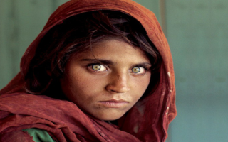     |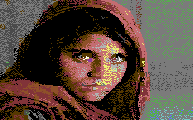  |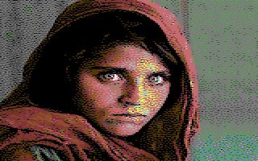
|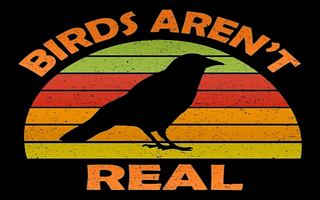            |         |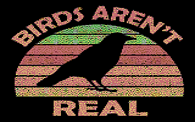
|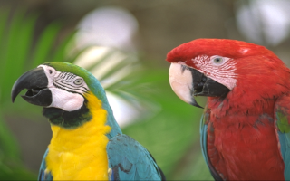          |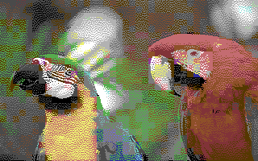       |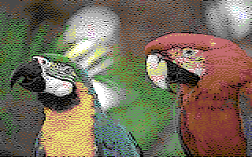
|image:examples/coffee.png[]         |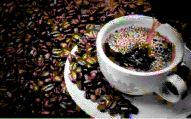      |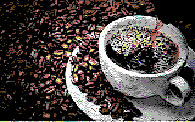
|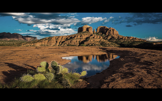         |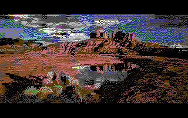      |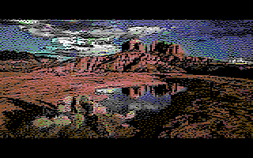
|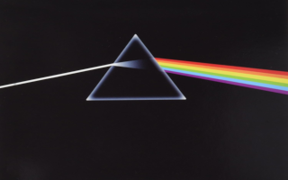          |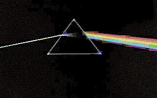       |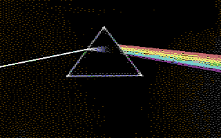
|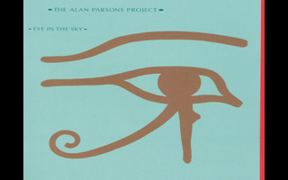           |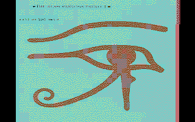        |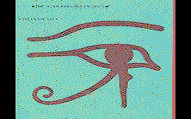
|image:examples/escher.png[]         |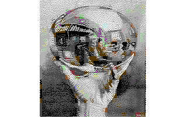      |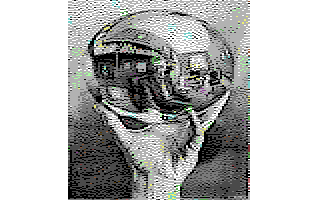
|image:examples/gc.png[]             |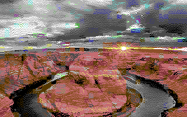          |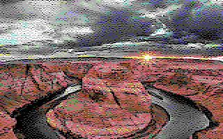
|image:examples/holi2.png[]          |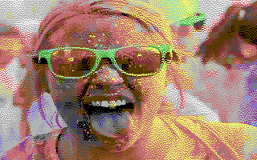       |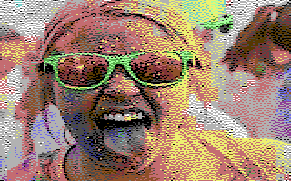
|image:examples/lena.png[]           |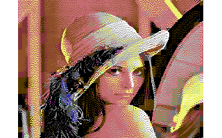        |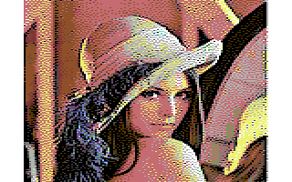
|image:examples/monarch.png[]        |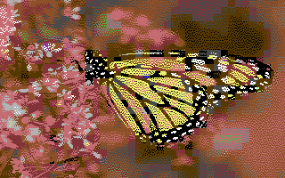     |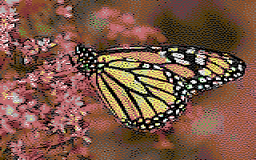
|             |image:examples/nd.hires.png[]          |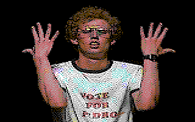
|image:examples/peppers.png[]        |image:examples/peppers.hires.png[]     |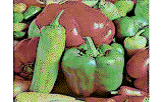
|image:examples/raytrace.png[]       |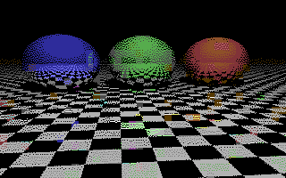    |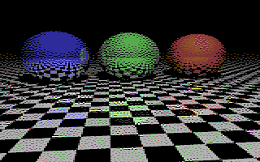
|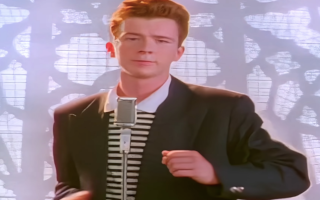             |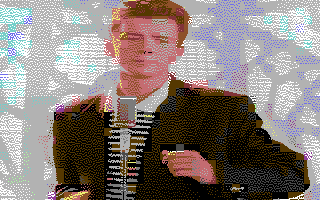          |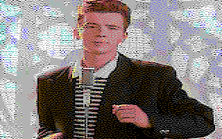
|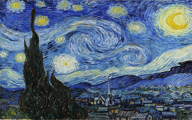   |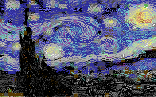|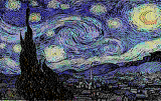
|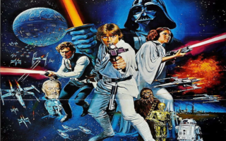      |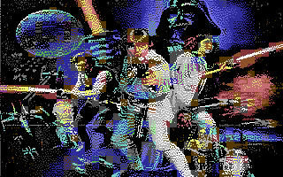   |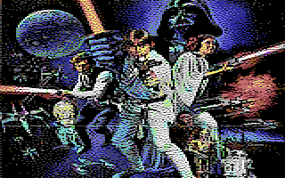
|image:examples/starwars.png[]       |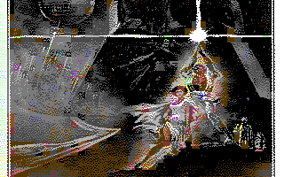    |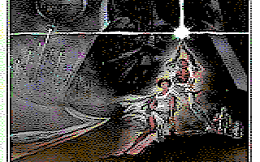
|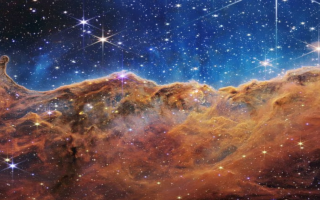           |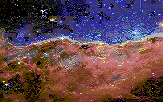        |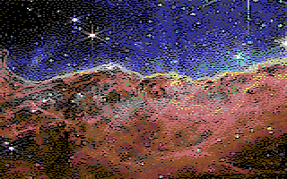
|===

== Future improvements

The evaluator functions are at the heart of the algorithms.
They determine which block is "best".

Currently the evaluators use a modified YUV color space as this maps reasonably well to our perception of which colors are "close" to each other.

Also, the pixel evaluator may be improved.
It currently uses a 3x3 convolution filter to allow neighboring pixels to influence the score of a pixel.
This causes the generated block to be dithered.
Alternative convolution coefficients give different results.
